# R47 Android Port: High-Precision RPN Scientific Calculator

[](https://www.gnu.org/licenses/gpl-3.0)
[-green.svg)](https://developer.android.com)
[](https://developer.android.com/guide/practices/page-sizes)
[](https://gitlab.com/rpncalculators/c43)
[](https://github.com/paletochen/r47_android/actions/workflows/android-ci.yml)

An advanced, photographic Android port of the [SwissMicros C43/C47 project](https://gitlab.com/rpncalculators/c43). R47 brings the venerable HP-42S lineage into the modern era, pairing the uncompromising 34-digit decimal precision and arbitrary-precision integer engine of the SwissMicros hardware with a rich suite of Android-native enhancements.

<p align="center">
  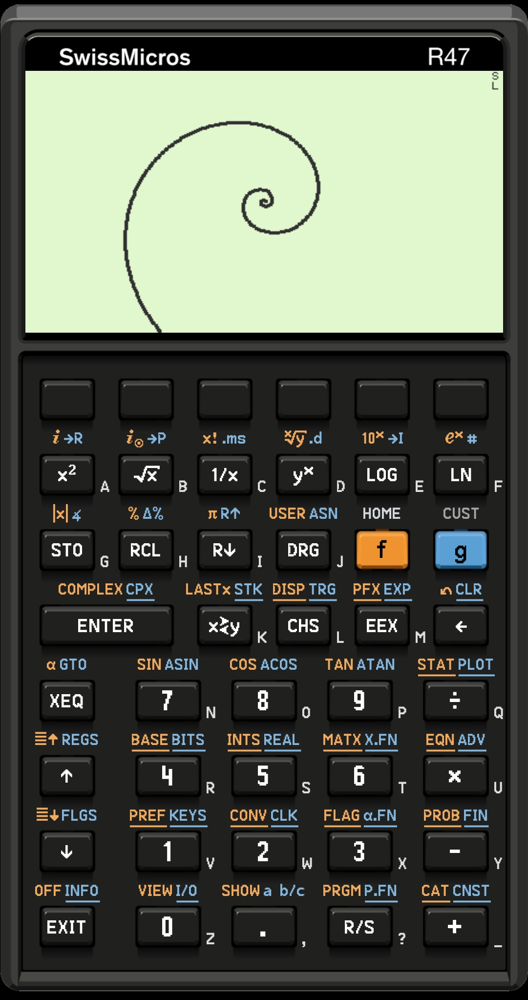
</p>

---

## 📱 Exclusive Android Features

While preserving 100% mathematical parity with the physical SwissMicros hardware and desktop simulators, the Android port introduces dozens of platform-native features designed specifically for touchscreen ergonomics, multitasking, storage workflows, and accessibility.

### 1. 🎨 Photographic & Dynamic Calculator Skins
Choose between authentic hardware aesthetics or clean, modern high-contrast interfaces via **Settings → Customization → Calculator Skin**:

| Skin | Style | Description | Preview |
| :--- | :--- | :--- | :---: |
| **SwissMicros (Replica)** | Hardware Photographic | 1:1 photographic reproduction of the textured bezel and physical keys of the SwissMicros hardware. | 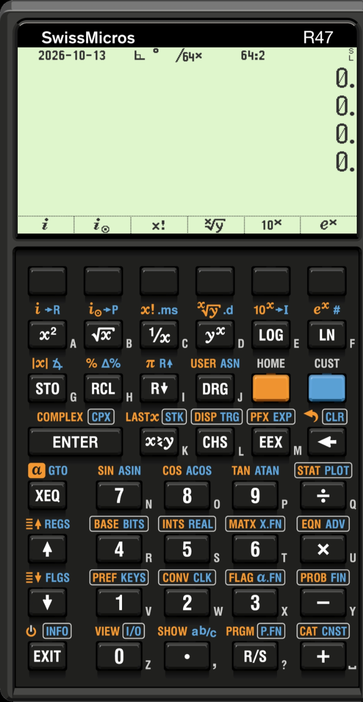 |
| **SwissMicros (Dynamic Labels)** | Hybrid Photographic | Authentic textured shell paired with on-the-fly dynamically rewriting keycap labels. | 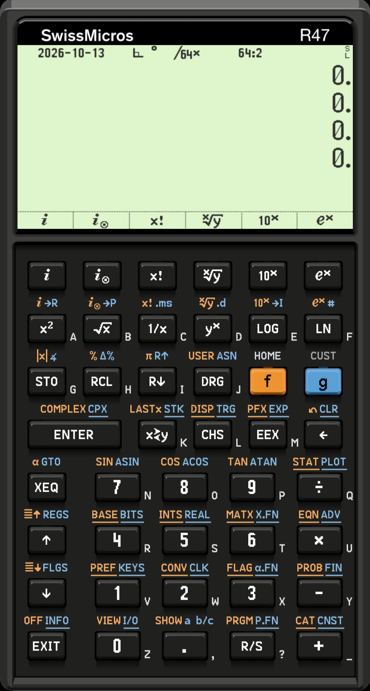 |
| **Chrome (Dynamic Labels)** | Modern Bezel | Sleek, dark anodized bezel with high-visibility dynamic keycap typography. | 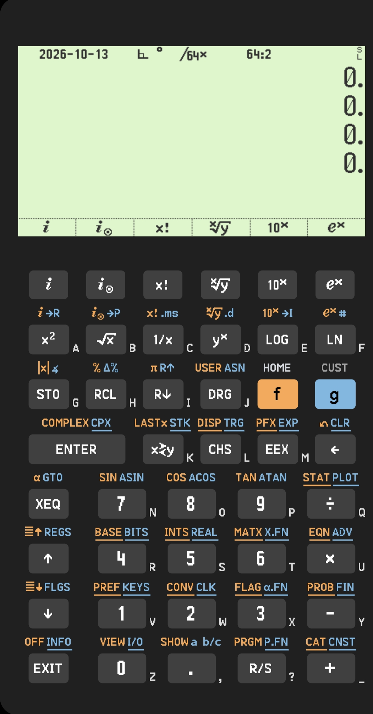 |
| **Simulator (Dynamic Labels)** | Clean Desktop Style | High-clarity vector key outlines based on the desktop simulator with separated shift indicators. | 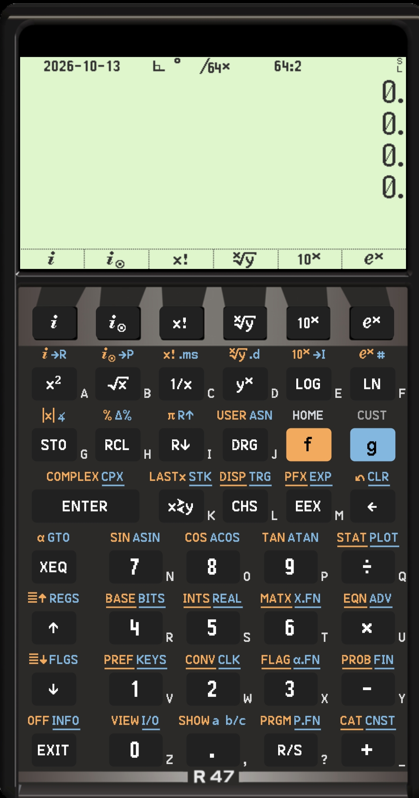 |
| **Das Kalkulator** | Industrial Custom | Distinctive brushed dark aesthetic with custom typography and tactile accents. | 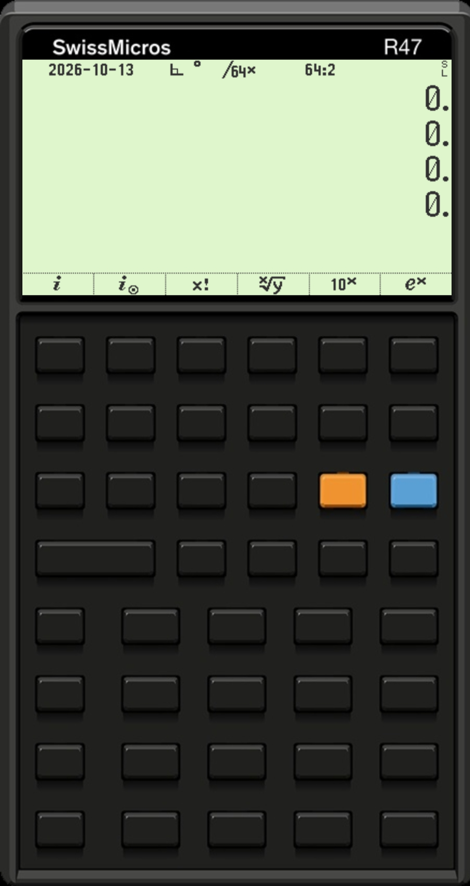 |

---

### 2. 🔤 Context-Sensitive Dynamic Keypad Engine
When using dynamic skins, the keypad adapts in real time to the calculator's internal state:
- **Dynamic Shift Rewriting**: Engaging `f`-shift (gold) or `g`-shift (blue) immediately rewrites the physical on-key labels to show the active secondary functions directly inside each keycap.
- **Dynamic USER Menu Keys**: Custom user key assignments dynamically replace the primary key labels on the fly.
- **Context-Sensitive ALPHA Mode**: Whenever character input is expected—even within programming sub-modes such as defining a label (`LBL`) or entering text arguments—the keypad automatically transitions into full alphabet entry.
- **Smart Anti-Clutter Typography**: When shift states are engaged, primary labels automatically shrink to prevent crowding, while high-frequency numeric keys (`0`–`9`) and operators (`+`, `-`, `×`, `÷`) remain 15% larger for maximum readability.
- **Collision-Free Label Positioning**: Secondary shift labels above keys use fine-tuned horizontal and vertical offsets to ensure zero text overlap even on dense multi-function keys (such as `DRG`, `x≷y`, and `BASE BITS`).

---

### 3. 📺 Dual LCD Modes & Display Ergonomics
- **Vintage Green Theme**: Faithfully replicates the low-power transflective memory LCD of the physical SwissMicros DM42 hardware.
- **High Contrast Theme**: Crisp, pure monochrome black-and-white display designed for bright sunlight or high-contrast preference.
- **Backlight Luminance Slider**: Direct control over screen brightness and contrast (adjustable from 60% to 120%).
- **Ergonomic Scaling Modes**:
  - **Adaptive Fit**: Intelligently expands to edge-to-edge full width on modern tall smartphone aspect ratios.
  - **1:1 Shell (Physical)**: Locks the on-screen dimensions to the exact physical millimeter measurements of the real calculator based on your device's screen DPI.
- **Immersive Fullscreen Mode**: Hide Android's status bar and navigation bar for uninterrupted calculation, or keep them visible when using three-button navigation.

---

### 4. 📋 Interactive Display Gestures & Smart Clipboard
Touch and hold anywhere on the calculator's LCD to open the native **Display & Clipboard** actions dialog:

```
┌─────────────────────────────────┐
│     Display & Clipboard         │
├─────────────────────────────────┤
│  Copy X Register                │
│  Copy All Registers             │
│  Paste to X Register            │
│  Enter PiP Mode                 │
│  Cancel                         │
└─────────────────────────────────┘
```

- **Format-Aware "Copy X Register"**:
  Copies the value of Register X directly to the system clipboard without display formatting spaces:
  - **Real Numbers**: Clean IEEE decimal representation (e.g. `1234567.89`).
  - **Complex Numbers**: Formatted in Cartesian or Polar coordinates (`3. + 4.i` or `5.∡53.130102...°`).
  - **Angle Multiples of $\pi$**: Copies cleanly as $\pi$-multiples (e.g. `2.πr` or `0.25π`).
  - **Date and Time**: Extracted directly as ISO strings (`2026-10-12` or `14:30:00`).
  - **Strings**: Lossless alphanumeric and Unicode string copying without truncation.
  - **Arbitrary-Precision Long Integers & Short Integers**: Full decimal or radix-tagged string.
  - **Full Matrices**: Instead of a generic `[matrix]` placeholder, matrices are formatted with full dimensions and elements:
    ```
    2x2
    1.5
    0.
    0.
    2.5
    ```
- **"Copy All Registers" (Full Memory Dump)**:
  Exports the entire calculator state in a single tap:
  - Stack registers (`T`, `Z`, `Y`, `X`, `LASTx`)
  - Global registers (`R00` through `R99`)
  - Local registers (`R.00`...)
  - Statistical accumulation registers (`SR00` through `SR26`)
  Cleanly formatted with `<Register> = <Value>` lines, ready to paste straight into spreadsheets, Jupyter Notebooks, or engineering notes.
- **Universal "Paste to X Register"**:
  Pastes clipboard text directly into Register X with automatic stack lift:
  - **Scalars & Scientific Notation**: Handles negatives, mantissas, and exponents (e.g. `-1.2345e-12`).
  - **Alphanumeric Strings**: Transparently ingests arbitrary strings and text (e.g. `"hello"`, `"Grüezi"`) into Register X as native string data (`dtString`) without producing `NaN`.
  - **Angular Units**: Automatically detects `:DEG`, `:RAD`, `:GRAD`, `°`, `deg`, `rad`, `grad`, `'r'`, and bare `π` / `2.πr`.
  - **Dates & Times**: Automatically converts `YYYY-MM-DD` or `HH:MM:SS` into native Date/Time registers.
  - **Matrix Ingestion**: Detects dimension headers (`X = 2x2` or `2x2`) followed by element rows, automatically reallocates Register X, and populates the matrix elements.
  - **International Formatting**: Normalizes European comma decimals (`1.234,56` $\rightarrow$ `1234.56`) and US comma groupings (`1,234.56` $\rightarrow$ `1234.56`).

---

### 5. 🪟 Picture-in-Picture (PiP) Floating Calculator
Multitask effortlessly by running R47 in a compact, interactive floating window over spreadsheets, web browsers, textbooks, and PDF documents:
- **Interactive Top Softkeys**: The F1 through F6 function keys remain fully operational while in PiP mode.
- **Fixed Hardware Aspect Ratio**: Locks to the calculator display's native 4860:2667 aspect ratio to eliminate letterboxing.
- **Quick Return**: Single tap restores the full-screen calculator layout.

---

### 6. 🔊 Integrated Audio Synthesis & Beeper Engine
Experience authentic acoustic feedback and run sound programs directly on Android:
- **Low-Latency PCM Audio**: Emulates the hardware piezo beeper using Android's `AudioTrack` with `USAGE_ASSISTANCE_SONIFICATION` and low-latency buffer management.
- **Acoustic RPN Commands**:
  - `BUZZ`: Plays precise custom frequencies (Hz) and durations (ms).
  - `PLAY`: Executes musical score matrices synthesized in RPN program memory (frequency/duration pairs).
- **Volume Control Commands**: Full execution of `VOL↑`, `VOL↓`, `VOL`, and `VOL?`.
- **In-App Preferences**: Beeper enable/disable toggle and dedicated volume slider (0–100%).
- **Interruptible Playback**: Respects calculator `FLAG_QUIET` and cancels playback instantly when a key is pressed.

---

### 7. 📳 High-Fidelity Tactile Haptic Engine
Simulate the distinct physical click of SwissMicros metal dome key switches:
- **Modern Haptic Primitives**: Leverages Android API 31+ `VibrationEffect.Composition` click primitives.
- **Adjustable Intensity**: Customize feedback strength from subtle clicks to firm mechanical snaps (0–255 slider).
- **Legacy Fallback**: Automatic graceful fallback for older Android devices.

---

### 8. 📂 Storage Access Framework (SAF) & Work Directory
Seamlessly connect the calculator to internal storage, SD cards, or cloud folders (Google Drive, Nextcloud):
- **Structured Storage Architecture**:
  - `STATE/`: Full calculator memory snapshots and named sessions.
  - `PROGRAMS/`: Standalone RPN program files and libraries.
  - `SAVFILES/`: Hardware-compatible auto-save snapshots (`R47auto.sav` / `C47auto.sav`). When configured, `R47auto.sav` auto-loads on boot or reset, exactly like flashing physical DM42 firmware!
  - `SCREENS/`: Full-resolution timestamped `.bmp` snapshots of the LCD screen via the `SNAP` command.
  - `DATA/`: Register backup and restore files (`.d47` format via `EXPreg`, `IMPORTr`, `EXPstk`, etc.).
  - `PRINT/`: Virtual thermal printer spooling. Infrared/thermal print commands (`PRN_XFN`, `PRINT`, etc.) spool directly to `PRINT/printer_output.txt`.
- **Optional TSV Export**: Export register tables and statistical data as standard `.TSV` files directly into the `DATA/` directory.

---

### 9. 🔋 Real Hardware Telemetry & Emulation
- **`BATT` / `BATT#` Battery Telemetry**: Queries Android's `BatteryManager` in real time to display live battery percentage and millivolt voltage directly on the LCD screen!
- **`DISK` Storage Inspection**: Queries Android's `StatFs` on your active partition to report available free storage space and filesystem blocks on the calculator's `TI_DISK_INFO` temporary display screen.
- **`SAVEAUT` & `DELBkup`**: Direct commands to create or clean up backup states in your Work Directory.

---

### 10. ⚙️ App Lifecycle & Power Management
- **Auto-Save on Minimize**: Automatically serializes calculator RAM when the app moves to the background (`onPause` / `onStop`), guaranteeing zero lost work.
- **Configurable `f`-shift `EXIT` Action**: Choose between minimizing the app to the background (keeping it in Recents) or finishing the activity completely.
- **Keep Screen On Toggle**: Prevents device sleep during long mathematical explorations or bench work.
- **Developer Touch Zones**: Visual overlay of keyhit bounding boxes and touch coordinates for layout verification.
- **Factory Reset**: Instant clean slate wipe and restart option in preferences.

---

## 📸 Visual Tour: High-Resolution LCD Capabilities

Powered by the 34-digit `decQuad` arithmetic engine, R47 supports rich data types and mathematical subsystems:

| Feature / Data Type | Description | Screen Preview |
| :--- | :--- | :---: |
| **Main Stack & Reals** | 4-level or 8-level RPN stack with up to 34 decimal digits of precision. | 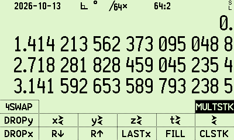 |
| **Complex Numbers** | Full complex arithmetic supporting both Cartesian and Polar representations. | 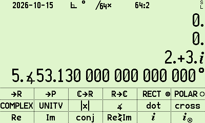 |
| **Matrix Operations** | Real and complex matrices with inversion, LU decomposition, and determinants. | 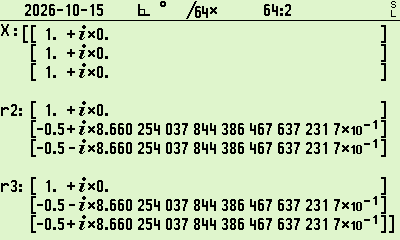 |
| **Arbitrary Precision Long Integers** | Arbitrary-length integers with customizable base and word length up to 64 bits. | 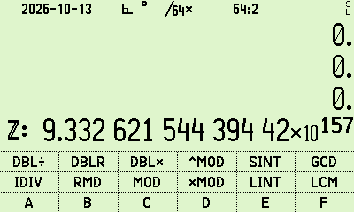 |
| **Base & Bit Logic** | Hexadecimal, decimal, octal, and binary operations with bitwise masking. | 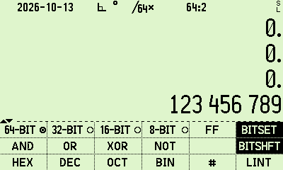 |
| **Plotting & Graphics** | On-screen function graphing, numerical differentiation, and curve exploration. |  |
| **Financial / TVM** | Time Value of Money, amortization tables, and cash flow analysis. | 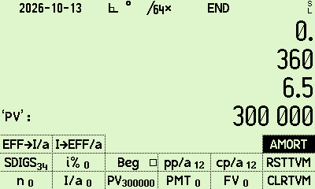 |
| **Root Finding & Solver** | Numerical equation solving, polynomial roots, and numerical integration. | 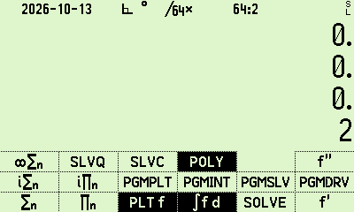 |
| **Clock, Time & Dates** | Comprehensive calendar, day-of-week, intervals, and real-time clock functions. | 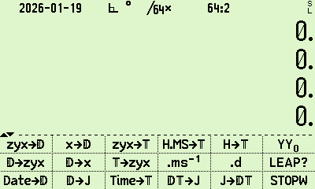 |

---

## 🛠️ Linux & macOS Dependencies

To build the desktop simulator or compile the Android APK from source, install the following packages:

### 1. Build Tools & Math Libraries
```bash
sudo apt-get update
sudo apt-get install git build-essential meson ninja-build libgmp-dev libgtk-3-dev libpulse-dev
```

### 2. Android Development SDK & NDK
- **Java**: OpenJDK 17 or higher.
- **Android SDK**: API 35 (Android 15) or API 36 (Android 16 preview).
- **Android NDK**: Version `29.0.14206865` or newer.

---

## 🚀 Building the Project

### 1. Clone & Sync Upstream Core
The repository contains the Android shell, JNI bridge, and build automation. Run the sync script to pull the mathematical core from upstream:
```bash
git clone https://github.com/paletochen/r47_android.git
cd r47_android
chmod +x sync_public.sh
./sync_public.sh
```

### 2. Build the Android APK
Ensure `ANDROID_SDK_ROOT` is configured in your shell:
```bash
./build_android.sh
```
The compiled APK will be generated at:
`android/app/build/outputs/apk/debug/R47calculator-debug-local.apk`

### 3. Build the Desktop Simulator (PC / Mac)
```bash
./dist.sh
```
This builds the GTK3-based desktop simulator and DM42/DM42n firmware binaries.

---

## ⚙️ Advanced Build Configuration

You can customize SDK, NDK, or CMake versions to match your local installation:

### Option A: `gradle.properties` (Cross-Platform / Recommended)
Create or edit `android/gradle.properties`:
```properties
r47.compileSdk=35
r47.targetSdk=35
r47.ndkVersion=29.0.14206865
r47.cmakeVersion=3.28.1
```
*Tip: To target Android 16 preview, set `r47.compileSdk=36` and `r47.targetSdk=36`.*

### Option B: Environment Variables (Linux / macOS / WSL)
```bash
export R47_NDK_VERSION="29.0.14206865"
./build_android.sh
```

### Option C: Windows Native (PowerShell / CMD)
**PowerShell:**
```powershell
$env:R47_NDK_VERSION="29.0.14206865"; ./build_android.sh
```
**Command Prompt (CMD):**
```cmd
set R47_NDK_VERSION=29.0.14206865 && ./build_android.sh
```

---

## 🧪 Quality Assurance & Test Suite

The project includes an automated verification harness with 13 native C invariant tests and Kotlin unit tests:
```bash
./test_android.sh
```
The test suite validates:
- Core item availability and softmenu mapping
- SNAP screenshot BMP header correctness
- Copy X ASCII cleanliness and IEEE formatting
- Virtual infrared thermal printer line buffering and frame yielding
- Audio frequency/duration clamping and bidirectional volume conversion
- Matrix LCD canvas layout and row fitting
- Softmenu frame and divider rasterization
- State save/restore integrity
- Battery telemetry and disk space reporting
- Picture-in-Picture window aspect ratios

---

## 📜 Acknowledgments & Reference Documentation

- **SwissMicros C43/C47 Core**: Based on the mathematical engine by the [WP43/C47 team](https://gitlab.com/rpncalculators/c43) and [SwissMicros](https://www.swissmicros.com/).
- **Official Owner's Manual**: The comprehensive 259-page reference manual (`C47_R47_calc.pdf`) is available under `docs/manual/` (built with `make -C docs/manual pdf` or `make pdf`), detailing RPN stack mechanics, registers, flags, menus, TVM, solvers, and structured programming.
- **Application Notes**: Extensive technical notes and specifications covering all advanced subsystems are available under `docs/appnotes/` (including AN0007 for structured programming, AN0012 for TVM, AN0020 for Matrix/Vector, and AN0025 for `.d47` register file formats).
- **License**: This Android port is licensed under the **GNU General Public License v3.0 (GPL-3.0)**.
- Independent community contribution; not officially affiliated with SwissMicros.
